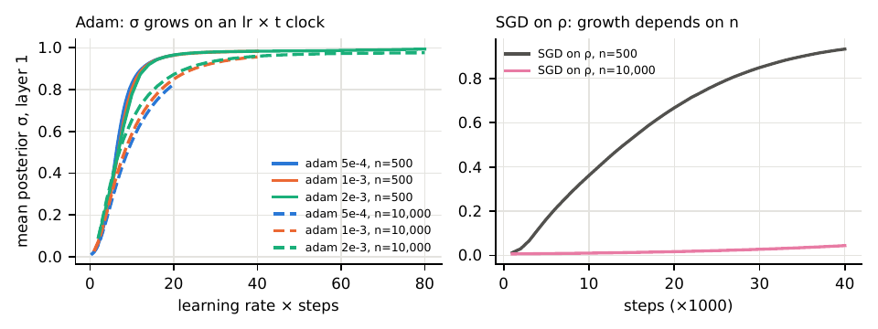
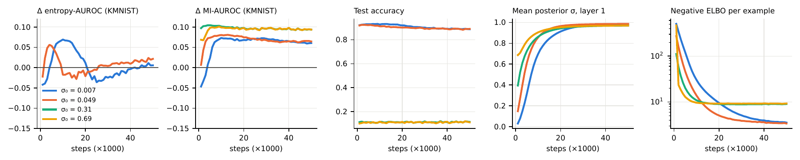

# On MNIST, Bayes by Backprop's OOD Advantage Runs on Optimizer Time

A study of out-of-distribution (OOD) detection with Bayesian neural networks,
built around a Bayes-by-Backprop (BBB) implementation written from scratch in
PyTorch. Every experiment's hypothesis, predictions and falsification
criteria were committed to git before it ran.

**Report:** [bnn.pdf](bnn.pdf) (12 pages; source `report/bnn.tex`)

## The question

A BNN averages predictions over a distribution of weights, so its outputs are
softer than a plain network's on *every* input. A plain network can be
softened for free with a temperature. So each method here is compared with a
plain network softened, on validation data only, to that method's own
in-distribution entropy. The question is whether the method separates OOD
inputs from in-distribution inputs better than a network of the same softness.

## Findings

On MLPs trained on MNIST (OOD sets: Fashion-MNIST, KMNIST):

1. **At standard training budgets, BBB is no better than the softness-matched
   network.** Deep ensembles are slightly better, MC dropout ties, and
   last-layer Laplace is worse (10 seeds per setting).
2. **With enough optimizer steps, BBB beats the control by +0.06 to +0.08
   AUROC**, and it also beats a plain network and a 5-member ensemble
   trained for the same number of steps (5/5 seeds everywhere). Adding random
   weight noise to a trained network does not reproduce it (BBB wins by
   +0.10 to +0.15), so the advantage depends on the variances BBB learns. A kNN
   detector on network features comes closest, within 0.02.
3. **When this happens is set by the optimizer, not the data.** Under Adam,
   the posterior standard deviations grow on a learning-rate × steps clock.
   Halving or doubling the learning rate doubles or halves the time, while a
   20-fold change in training-set size changes it by at most 20%. Under SGD,
   growth depends strongly on the data size, and where σ stays small BBB shows
   no advantage at all. This holds without gradient clipping too, but
   unclipped SGD on σ diverges once σ grows large.
4. **The uncertainty score and the prior matter.** With the default N(0,1)
   prior, the entropy-based advantage can disappear later in training as the
   model underfits, while the mutual-information (MI) advantage persists. With
   a prior of scale 0.3, both persist. MI is also high for runs that never
   learned, so MI alone does not show a useful model.
5. **Why it happens is derived, not just observed:** Adam turns the KL term's
   nearly constant gradient into a fixed step per update, which predicts the
   timing to within a factor of 1.3–1.5 with no fitted constants (report §3.4).
6. **The advantage needs posterior noise in both hidden layers together**, and
   it is not a pixel shortcut.
7. **Neither held-out NLL nor the ELBO picks a good stopping point.** A
   synthetic-outlier rule does no better than a fixed step count, which is
   what the optimizer clock predicts.

On CIFAR-10 with small, underfit models (37–68% accuracy), no comparable
advantage appears. That result says little about well-trained networks.





## How the study got here

The project started from a simpler question ("is the BNN's advantage just
softness?"). Many of my pre-registered predictions failed: 18 of 43, listed
in the report's appendix. Those failures are what led to the training-path
account. Each step is in [experiments/](experiments/) (E1–E9, E7b), with the
prediction written first and the result added after the run.

## Limitations and next steps

Only three prior scales were tried, at one data size. The dynamics runs use
a constant learning rate and 3 seeds, and the clock was tested with Adam and
SGD on one architecture; a kNN feature detector comes within 0.02 of BBB. There is no exact-posterior (HMC) reference, and the
CIFAR models are small and underfit. Planned next: ResNet-20 with augmentation
on CIFAR-10 (BBB, IVON, ensembles), HMC on a small MLP, and IVON on MNIST.

## Methodological notes

- **KL scaling.** With the cross-entropy averaged over a mini-batch, the
  per-example ELBO needs `KL / N`. Dividing by the number of mini-batches
  instead over-weights the KL term by about the batch size (62.5× at N = 2,000)
  and costs about 3 points of accuracy. It is kept as an ablation (`bbb_bug`).
- **No fixed-threshold rejection rates.** Comparisons use threshold-free
  AUROC, paired by seed, with bootstrap CIs.
- **Every number in the report is traced** to a result file in
  [CLAIMS.md](CLAIMS.md).

## Repository layout

```
bnn.pdf                       report (source: report/bnn.tex, report/refs.bib)
bnnstudy/                     code
  data.py, models.py          MNIST data; DNN, MAP, MC dropout, ensemble, BBB, last-layer Laplace
  train.py, evaluate.py       one run -> per-sample predictions; metrics + softness-matched controls
  compare.py                  paired per-seed comparisons (bootstrap CI, Wilcoxon)
  dynamics.py                 BBB training dynamics with checkpoint-wise evaluation (E6, E9)
  cifar.py                    CIFAR-10 pipeline, CNN and MLP (E7, E7b)
  softmatch.py                softness-matched comparison for on-the-fly variants
experiments/<id>/protocol.md  pre-registered hypotheses and predictions, with results
scripts/                      run scripts, analysis and figure scripts
results/<id>/                 metrics and summaries (per-sample .npz and model .pt files are not tracked)
figures/                      report figures
COMMANDS.md, CLAIMS.md           every command run; every report number -> its source file
```

## Reproduce

Every command actually run, in order, is in [COMMANDS.md](COMMANDS.md).
Developed with torch 1.9 (CUDA 11.1) on RTX 3090s. The datasets download into
`data/` on first run.

```bash
pip install -r requirements.txt
scripts/run_E1.sh                          # pilot, ~4 min
scripts/run_E6.sh 0 -5 -3                  # training dynamics, ~15 min per GPU
python scripts/analyze_E6.py
cd report && pdflatex bnn && bibtex bnn && pdflatex bnn && pdflatex bnn
```

## License

MIT — see [LICENSE](LICENSE).
